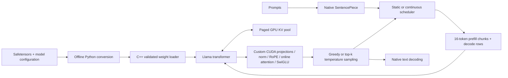

# LLM Inference Engine

A C++17/CUDA implementation of Llama inference: custom linear kernels, RMSNorm,
RoPE, online-softmax attention, group-wise INT8 weights, paged KV storage, and
continuous request batching. Python prepares model assets and runs reference
validation; the inference executable does not import Python or use framework tensors.

**Status: experimental, GPU validation outstanding.** Host infrastructure, checkpoint
conversion/loading, and native tokenization have been tested on macOS ARM64.
CUDA source and performance have **not** been compiled or run on NVIDIA hardware
in this environment. The C++ transformer and scheduler also pass a tiny Hugging Face
comparison using an explicitly test-only CPU arithmetic backend. This is not a production certification.
See [implementation status](docs/implementation_status.md) and
[measured results](results/benchmark_results.md) before relying on a feature.

The project makes the memory layout, precision choices, causal masking, allocation
policy, and batching decisions explicit so their correctness and cost can be inspected.
It does not claim parity with mature inference runtimes.



## Build

NVIDIA execution requires Linux or another supported CUDA host, CMake 3.24+, a
C++17 compiler, CUDA 12.x, and a compatible NVIDIA GPU. The default architecture
list is 75/80/86/89; override with `-DCMAKE_CUDA_ARCHITECTURES=90` where needed.
SentencePiece v0.2.0 is fetched at configure time. For offline builds pass
`-DFETCHCONTENT_SOURCE_DIR_SENTENCEPIECE=/path/to/sentencepiece-0.2.0`.

```bash
./scripts/setup.sh
source .venv/bin/activate
./scripts/build.sh cuda
./scripts/test.sh build-cuda
```

An explicit host-only build runs systems and checkpoint-format tests. It does not
build an inference executable or substitute CPU timings for CUDA measurements:

```bash
./scripts/build.sh host
./scripts/test.sh build-host-release
# Optional native tokenizer build on macOS/Linux:
./scripts/build.sh host -DLLM_TOKENIZER=ON
```

## Prepare TinyLlama

```bash
python python/download_model.py --output models/tinyllama-hf
python python/convert_weights.py models/tinyllama-hf models/tinyllama-fp16 --precision fp16
python python/convert_weights.py models/tinyllama-hf models/tinyllama-fp32 --precision fp32
python python/convert_weights.py models/tinyllama-hf models/tinyllama-int8 --precision int8 --group-size 128
```

The download is pinned to TinyLlama-1.1B-Chat-v1.0 revision
`fe8a4ea1ffedaf415f4da2f062534de366a451e6`, which includes `tokenizer.model`.
Model assets have their own licenses; the repository MIT license applies to this code.
Conversion reads the actual configuration, rejects unsupported architectural options,
and explicitly selects output precision. BF16 source weights are promoted offline
before conversion because NumPy lacks native BF16 support. Norm weights and INT8
scales are FP32. Embeddings remain FP16 in INT8 mode.

## Generate

```bash
./build-cuda/llm_inference --model models/tinyllama-fp16 \
  --prompt "Explain how CUDA kernels work." --chat --max-tokens 128 \
  --temperature 0.7 --top-k 40 --precision fp16

./build-cuda/llm_inference --model models/tinyllama-fp16 --interactive --chat

./build-cuda/llm_inference --model models/tinyllama-fp16 \
  --requests configs/workload.tsv --batch-size 8 --kv-block-size 16 \
  --kv-blocks 1024 --policy continuous --benchmark
```

`--precision` checks actual linear weight storage; it does not silently convert model weights.
All runtime activations and KV entries are FP32, including with FP16/INT8 weights.
`--tokens 1,15043` bypasses text tokenization. `--logits output.bin` exports row-major
FP32 logits for every input token, using incremental cache execution.

The C++ API exposes `Engine::generate(prompt_tokens, max_new_tokens, temperature,
top_k)` and `Engine::run(requests, policy)`. Temperature zero is greedy. Each engine
has a reproducible PRNG seed. EOS terminates generation. Single-user chat formatting
matches the pinned TinyLlama template; a general multi-turn conversation API is not provided.

## Engineering details

* **Linear kernels:** naive and 16×16 shared-memory tiles; coalesced activation and
  weight loads, transposed padded weight tiles, FP32 accumulation, boundary guards.
  FP32/FP16/INT8 weight paths and a separate FP16-input GEMM entry point are provided.
  No Tensor Core kernel or autotuner is implemented.
* **Attention:** separate score/softmax/value baseline and a fused kernel with
  32-key shared-memory tiles. It rescales a running maximum, normalization sum,
  and output accumulator and never writes a global attention matrix. It supports
  causal prefill/decode and grouped-query heads. This is a straightforward
  FlashAttention-style algorithm, not the optimized FlashAttention library.
* **Quantization:** symmetric groups along each output row, signed INT8 storage,
  FP32 scale per group, and dequantization inside GEMM tile loading. Model-file size
  includes scales and metadata. Perplexity is an independent validation requirement.
* **KV cache:** fixed physical blocks, host-owned free list, per-request logical
  tables, direct paged GPU reads/writes. No contiguous gather on decode. The GPU
  pool is allocated once; only assignment of its blocks is dynamic.
* **Batching:** FIFO admission at token boundaries, independent request state,
  16-token prompt chunks, one decode row per active request, and shared GPU
  projections across packed rows. Static mode holds the next admission group until
  the current group drains. Requests can have scheduled arrival times.

See [architecture](docs/architecture.md), [kernels](docs/kernels.md),
[cache](docs/kv_cache.md), and [batching](docs/batching.md).

## Validate

```bash
ctest --test-dir build-cuda --output-on-failure
python tests/test_tokenizer.py --assets models/tinyllama-hf --binary build-cuda/tokenizer_dump
python tests/test_inference.py --binary build-cuda/llm_inference \
  --model models/tinyllama-fp32 --reference-model models/tinyllama-hf --device cuda
python python/validate_logits.py --binary build-cuda/llm_inference \
  --model models/tinyllama-fp32 --reference-model models/tinyllama-hf --tokens 1,15043
compute-sanitizer --tool memcheck ./build-cuda/test_kernels
compute-sanitizer --tool racecheck ./build-cuda/test_kernels
```

The strict 1e-3 absolute logit gate compares FP32 weights/activations with an FP32
Hugging Face eager reference. It has not yet been executed. FP16 or INT8 comparisons
must be labeled with their actual numerical modes; tolerances are not relaxed silently.

## Benchmark

```bash
./scripts/benchmark.sh models/tinyllama-fp16
python benchmarks/benchmark_batching.py --binary build-cuda/llm_inference \
  --model models/tinyllama-fp16 --requests configs/workload.tsv
python benchmarks/benchmark_quantization.py --binary build-cuda/llm_inference \
  --fp16-model models/tinyllama-fp16 --int8-model models/tinyllama-int8 \
  --reference-model models/tinyllama-hf
```

Kernel benchmarks use five warmups and 30 CUDA-event repetitions. End-to-end runs
warm up the model, exclude loading, synchronize via output transfer, and measure wall
clock including scheduling and sampling. JSON retains raw timings and GPU metadata.
[Methodology](docs/benchmarks.md) describes denominators and limitations.

No GPU throughput, attention speedup, logit accuracy, or perplexity target has been
verified. The analytical variable-length cache example reduces **assigned-capacity
waste** by 99.72%; it does not demonstrate a corresponding reduction in reserved VRAM.

## Remaining work before production use

Run the full CUDA build, kernel tests, sanitizer tools, TinyLlama integration suite,
and benchmark matrix on NVIDIA hardware. Optimize only after collecting profiles.
The current GEMM is a teaching-quality tiled implementation, the attention CTA handles
one query/head, and all activations/KV are FP32. No claim of 80% cuBLAS, 3.5× attention,
47% storage reduction, <0.1 perplexity increase, or 3× serving throughput is made.

The scheduler is a synchronous workload runner, not a network server or thread-safe
live submission service. Cache exhaustion fails the affected request explicitly;
there is no swap/preemption/retry policy. GPU counters track owned Tensor allocations,
not total device/driver memory. Model loading stages one tensor through host memory.
Host AddressSanitizer startup stalled on this machine; ordinary and UndefinedBehaviorSanitizer
host tests passed. A CI workflow is included for Linux host tests and CUDA compilation;
it has not been run in this session and does not claim GPU runtime coverage.
